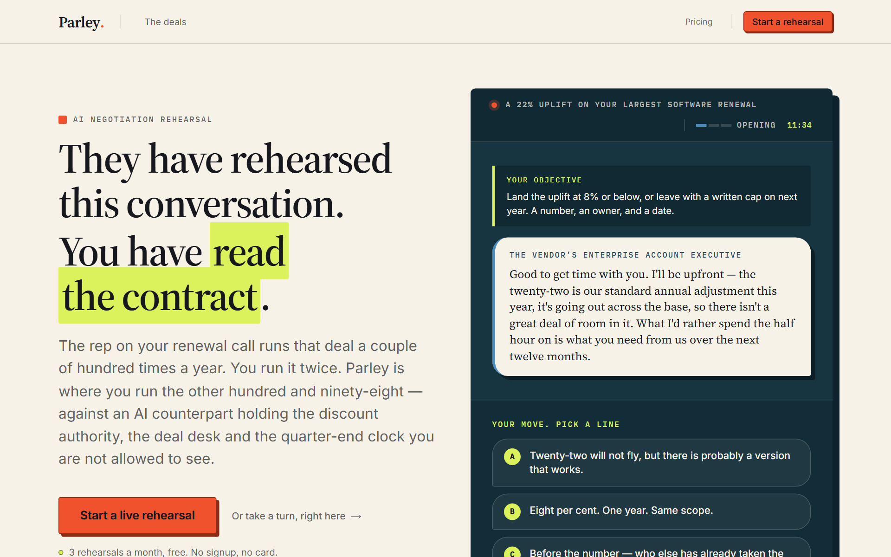
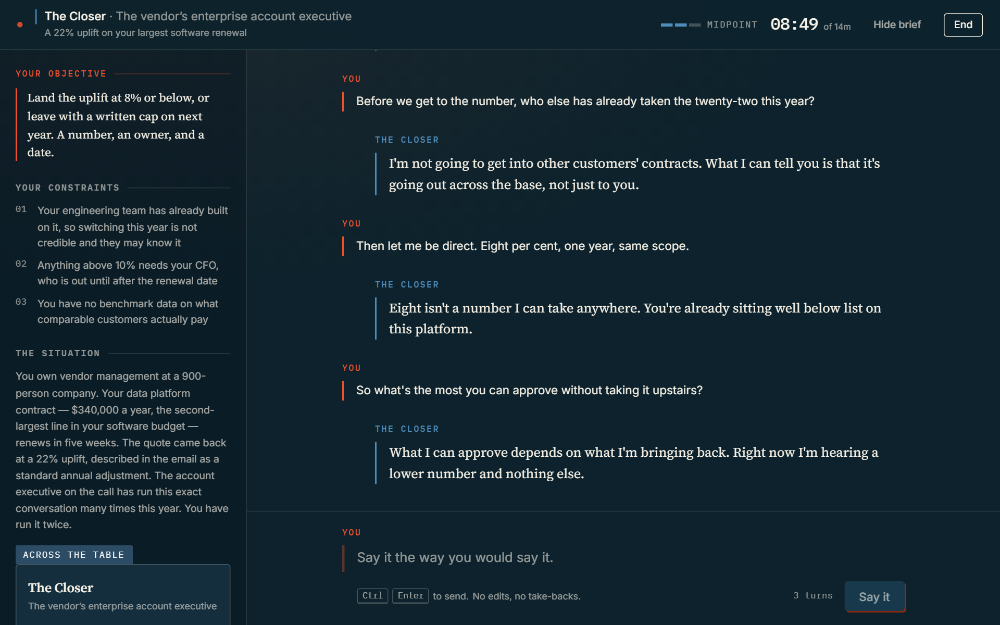
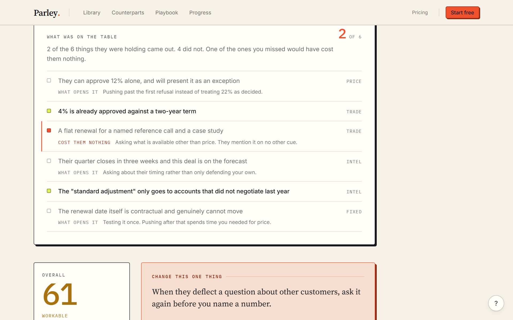
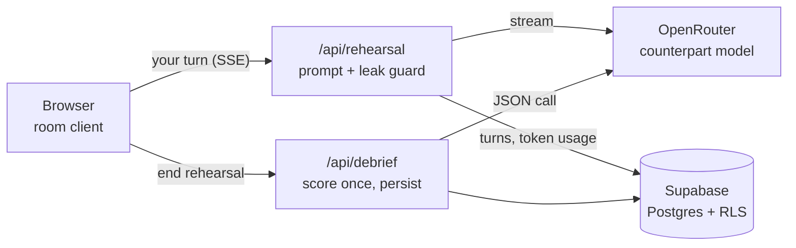

# Parley

**Rehearse a vendor negotiation against an AI counterpart that is hiding
something. Then see exactly what your version of the call cost.**

**Live demo:** not deployed yet.

You pick a deal: a 22% renewal uplift, a "best and final" that is really one
person's approval limit, an upsell bundled into a renewal to hide the baseline.
You rehearse it live against a vendor rep holding a mandate you cannot see:
their real discount authority, the person above them, and what they will trade
for a signature date. When the call ends, the transcript is scored across five
negotiation dimensions and the mandate is revealed as a ledger. Two of the five
things they were holding came out, three did not, and here is the question that
would have opened each one.

| The landing: a playable console, one click to a real room | The room: live, streamed, in character | The debrief: scored once, mandate revealed |
|---|---|---|
|  |  |  |

<sub>Screenshots render the real interface against fixture data, not a live
session.</sub>

## What makes it hard to build

A chat UI over a model is an afternoon. Three things here are not:

1. **The counterpart must not fold.** Instruction-tuned models agree with
   anyone who sounds confident. The prompt in `lib/negotiation/prompt.ts`
   carries a concession ladder: movement has to be earned by a question or a
   trade, never granted for tone. It also never coaches, praises or admits it
   is a simulation, because live feedback trains a skill the real meeting will
   not reward.
2. **The answer must never reach the browser early.** The mandate is what the
   user is trying to discover. See [how it is protected](#how-the-mandate-is-protected).
3. **The score must mean something over time.** A debrief is generated once
   and persisted (enforced by a unique constraint), so re-opening it never
   re-rolls the numbers and the progress trend is real.

## Architecture



- **Next.js App Router, React, TypeScript.** Server components project
  redacted scenarios; client components never import the source of truth.
- **Supabase.** Postgres with row-level security on every table and no client
  policies; the server is the only reader.
- **OpenRouter.** A streaming call for the counterpart and a separate
  low-temperature JSON call for the debrief. Both models are env vars.
- **Stripe.** Checkout, webhook (raw-body signature check) and billing portal.
  Metered by rehearsals per month.

## How the mandate is protected

Defence in depth, and every layer has a test that fails if it regresses.

| Layer | What it does | Proof |
|---|---|---|
| Build | `scenarios`, `prompt`, `openrouter` and `supabase-server` import `server-only`. Importing one from a client component fails `next build`. | [`lib/negotiation/scenarios.ts`](lib/negotiation/scenarios.ts) |
| Bundle | Walks the real import graph from every `'use client'` file and fails if any path reaches the mandate. | [`tests/client-bundle-secrets.test.ts`](tests/client-bundle-secrets.test.ts) |
| Routes | Every API route must be classified. The ones that touch a scenario are called in every rehearsal state, for every scenario, and must not return the mandate while the rehearsal is live. | [`tests/mandate-boundary.test.ts`](tests/mandate-boundary.test.ts), [`tests/redact.test.ts`](tests/redact.test.ts) |
| Stream | A shingled leak detector checks the accumulated reply on every read, and the stream holds back its last few words until the detector has judged them. | [`lib/negotiation/leakGuard.ts`](lib/negotiation/leakGuard.ts), [`tests/injection.test.ts`](tests/injection.test.ts), [`tests/streaming.test.ts`](tests/streaming.test.ts) |
| Prompt | The model is told not to disclose, and adversarial probes (direct override, fake system messages, incremental extraction) measure whether it holds on its own. | [`evals/prompt-probe.ts`](evals/prompt-probe.ts) |

The same care goes into cost. A deployment-wide daily token ceiling, recorded
with an atomic database upsert, bounds what an anonymous visitor can spend;
a cut-short stream is still charged for the prompt it sent.

## Run it locally

```bash
npm install
cp .env.local.example .env.local   # fill in the values below
npm run dev
```

Apply `supabase_migrations.sql` to a fresh Supabase project first (SQL Editor,
paste, run). It is written for an empty project, not as a migration from any
other schema. Then open http://localhost:3000.

```text
NEXT_PUBLIC_SUPABASE_URL=...
NEXT_PUBLIC_SUPABASE_ANON_KEY=...
SUPABASE_SERVICE_ROLE_KEY=...

OPENROUTER_API_KEY=...
OPENROUTER_ROOM_MODEL=...       # optional, the counterpart model
OPENROUTER_DEBRIEF_MODEL=...    # optional, the scoring model
GLOBAL_DAILY_TOKEN_BUDGET=...   # optional, daily spend ceiling; -1 disables

NEXT_PUBLIC_SITE_URL=http://localhost:3000
ADMIN_PASSWORD=...              # gates /admin and /api/admin/*
```

Optional, per integration: `STRIPE_SECRET_KEY`, `STRIPE_WEBHOOK_SECRET` and the
`STRIPE_PRICE_*` ids; `RESEND_API_KEY` and `EMAIL_FROM`. Never commit secrets.

## Tests

```bash
npx tsc --noEmit
npm run lint
npm test          # 630+ unit and integration tests; no network, no rows written
npm run build
```

`evals/` holds two manual harnesses that spend real model calls:
`prompt-probe.ts` (prompt only, needs just an OpenRouter key) and `run.ts`
(end to end against a running app). Both check that the counterpart behaves
like an opponent, not an assistant. See [`evals/README.md`](evals/README.md).

## The domain in one paragraph

A **scenario** is the deal on paper. A **counterpart** is who the vendor puts
on the call. A **rehearsal** is one timeboxed attempt. A **debrief** is the
scored read of what you actually said. A **lever** is one thing the
counterpart is holding: a number they can approve, a trade they will make, a
fact about their incentives, or something that genuinely will not move. Every
scenario has at least one lever that costs the vendor nothing and is never
volunteered, which is the lesson the exercise exists to deliver.

Scenarios and built-in counterparts live in `lib/negotiation/` as versioned
code, not database rows, because a hidden mandate is prompt logic and belongs
in code review.

```text
app/room/[id]/          The live rehearsal, the only dark surface in the app
app/debrief/[id]/       Scores, key moments, mandate ledger, transcript
app/library/            Deal library and briefs
app/api/rehearsal/      Streaming counterpart turns and session lifecycle
app/api/debrief/        Debrief generation and retrieval
lib/negotiation/        Scenarios, counterparts, dimensions, prompts, scoring
evals/                  Counterpart-behaviour harnesses
```

See `docs/product-direction.md` for who this is for and why this wedge was
chosen.

## Before deploying your own copy

1. Set the environment variables above, with `NEXT_PUBLIC_SITE_URL` set to the
   real URL.
2. Apply the schema.
3. Put a credit limit on the OpenRouter key. It is the real backstop behind the
   daily ceiling.
4. For billing, create the Stripe products (`POST /api/stripe/setup-products`
   with the admin password) and copy the price ids into the environment.
5. Several pages show a visible `[configure: ...]` marker where a business fact
   belongs (legal entity, contacts, effective dates). Search for `Configure` in
   `app/components/ContentPage.tsx`. Prices in `lib/plans.ts` are placeholders
   and the pricing page labels them as demo pricing until
   `NEXT_PUBLIC_PRICING_LIVE=true`.
